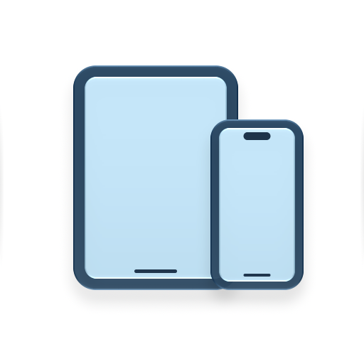

# USB Display



[简体中文](#简体中文) | [English](#english)

## 简体中文

USB Display 是一款原生 macOS 应用，可以通过 USB 将 iPhone 或 iPad 的画面显示在可调整大小的窗口中。基于 SwiftUI、AppKit 和 AVFoundation 构建，无需在手机或平板上安装配套应用，也无需注册账号。

### 下载

**[下载 v1.0.1 macOS 通用版 — DMG](https://github.com/BoboX-NPU/USBDisplay/releases/download/v1.0.1/USBDisplay-1.0.1-macOS-universal.dmg)**

[ZIP 下载](https://github.com/BoboX-NPU/USBDisplay/releases/download/v1.0.1/USBDisplay-1.0.1-macOS-universal.zip) · [SHA-256 校验文件](https://github.com/BoboX-NPU/USBDisplay/releases/download/v1.0.1/SHA256SUMS.txt) · [发布说明与历史版本](https://github.com/BoboX-NPU/USBDisplay/releases)

需要 **macOS 14 或更新版本**和支持数据传输的 USB 线。同一安装包包含 Apple Silicon 和 Intel 两种架构。使用预编译应用不需要安装 Xcode。

**签名状态：** v1.0.1 安装包内的应用已使用 **Developer ID 签名并通过 Apple 公证**，附带离线公证票据，且通过了 Gatekeeper 检查。首次打开仍可能显示正常的互联网下载确认与“相机”权限提示。详见[安装说明](doc/installation.md)。旧版 macOS 和 Intel 设备的实机验证尚不完整；最低系统要求不代表所有配置均已测试。

### 功能

- 通过有线连接显示 iPhone 或 iPad 画面，支持等比例调整窗口和全屏查看。
- 为不同设备提供独立窗口和采集会话。
- 支持调整设备侧栏宽度，以及鼠标悬停时显示的紧凑控制栏。
- 识别设备型号，并根据内置资料匹配屏幕圆角。
- 显示连接、解锁/信任、权限和采集中断状态。

应用只在本机显示视频，不录屏、不采集音频、不远程传输画面，也不能控制 iPhone/iPad。受 DRM 保护的内容可能显示为黑屏。USB 画面来源由操作系统提供，可用性可能因设备和系统版本而异。

### 开始使用

1. 从 DMG 或 ZIP 安装 `USB Display.app`。
2. 使用 USB 数据线连接已解锁的 iPhone/iPad，并完成设备上的信任提示。
3. 打开应用，并在 macOS 提示时允许“相机”权限。AVFoundation 需要此权限读取设备视频流；应用不会使用 Mac 摄像头。
4. 在侧栏选择设备。通过设备的右键菜单，可以在另一个窗口打开尚未被其他窗口占用的设备。

遇到首次启动被拦截、设备不显示、黑屏或权限问题时，请查看[安装与故障排查](doc/installation.md)。

### 构建与测试

当前源码和分层图标已使用 **Xcode 27.2** 验证。构建前请选择完整的 Xcode 安装；当前版本尚未验证更旧的工具链。

```bash
git clone https://github.com/BoboX-NPU/USBDisplay.git
cd USBDisplay
./script/build_and_run.sh --verify
```

运行应用测试和离线设备资料检查：

```bash
./script/test.sh
PYTHONDONTWRITEBYTECODE=1 python3 script/test_device_profiles.py
PYTHONDONTWRITEBYTECODE=1 python3 script/update_device_profiles.py --check
```

测试使用独立临时目录，并在完成或正常中断后自动清理。日常应用构建保留在 `.build/Xcode`，发布包保留在 `.build/Distribution`。测试筛选和贡献流程见 [CONTRIBUTING.md](CONTRIBUTING.md)。托管 CI 仍是后续任务；本地测试结果不等于 GitHub Actions 已通过。

### 项目结构

| 目录 | 职责 |
| --- | --- |
| `USBDisplay/App/` | 应用与场景入口 |
| `USBDisplay/Models/` | 设备、连接状态、布局与缩放策略 |
| `USBDisplay/Services/` | 设备发现、采集状态与只读 USB 识别 |
| `USBDisplay/Views/` | SwiftUI 页面、AppKit 容器、工具栏和窗口交互 |
| `USBDisplay/Resources/` | 应用图标、设备资料和第三方声明 |
| `USBDisplayTests/` | 采集、设备识别、布局和渲染回归测试 |
| `Config/`、`USBDisplay.xcodeproj/` | 应用元数据、权限和构建配置 |
| `script/`、`data/device-profiles/` | 开发工具与固定版本的资料来源 |
| `doc/`、`.github/` | 用户/维护文档和协作模板 |

新功能应放在现有分层中；只有在职责清晰且能独立验证时，才引入新的模块。

### 参与开发

- [报告问题或提出功能建议](https://github.com/BoboX-NPU/USBDisplay/issues/new/choose)。
- 阅读[贡献指南](CONTRIBUTING.md)、[路线图](doc/roadmap.md)和[更新日志](CHANGELOG.md)。
- 维护者使用独立的 Linear 项目规划任务；公开贡献通过 GitHub 进行，不需要 Linear 账号。
- 架构细节与验证范围见[当前项目状态](doc/current.md)，发布流程与历史记录见[发布指南](doc/releases.md)和[开发日志](doc/devlog.md)。其余开发文档以英文维护。

### 许可证与致谢

采用 [MIT 许可证](LICENSE)。设备资料包含固定版本的 DeviceKit 与 BezelKit 数据，并保留其[第三方声明](USBDisplay/Resources/ThirdPartyNotices.txt)。资料来源、冲突处理和验证范围见[设备资料说明](doc/device-corner-profiles.md)。本项目独立于 Apple。

---

## English

A native macOS app for displaying a USB-connected iPhone or iPad in a resizable window. Built with SwiftUI, AppKit, and AVFoundation. No companion app or account is required.

### Download

**[Download v1.0.1 for macOS — DMG](https://github.com/BoboX-NPU/USBDisplay/releases/download/v1.0.1/USBDisplay-1.0.1-macOS-universal.dmg)**

[ZIP download](https://github.com/BoboX-NPU/USBDisplay/releases/download/v1.0.1/USBDisplay-1.0.1-macOS-universal.zip) · [Checksums](https://github.com/BoboX-NPU/USBDisplay/releases/download/v1.0.1/SHA256SUMS.txt) · [Release notes and all versions](https://github.com/BoboX-NPU/USBDisplay/releases)

Requires **macOS 14 or later** and a USB data cable. The same download includes Apple Silicon and Intel executables. Xcode is only needed to build from source.

**Signing status:** the app in v1.0.1 is **Developer ID signed and notarized by Apple**, includes a stapled ticket for offline verification, and passes Gatekeeper checks. Normal first-launch download confirmation and Camera permission prompts can still appear. See the [installation guide](doc/installation.md). Older macOS and Intel runtime coverage is still incomplete; the minimum deployment target is not a claim that every configuration has been physically tested.

### What it does

- Displays a wired iPhone or iPad screen with proportional resizing and full-screen viewing.
- Keeps separate windows and capture sessions for selected devices.
- Offers a resizable device sidebar and compact controls that appear on hover.
- Resolves device models and applies display-corner profiles from a bundled catalog.
- Shows connection, unlock/trust, permission, and interruption states.

The app displays video locally. It does not record, capture audio, transmit the screen remotely, or control the iPhone/iPad. DRM-protected content may appear black. USB capture is provided by the operating system, and availability can vary by device and software version.

### Get started

1. Install `USB Display.app` from the DMG or ZIP.
2. Connect an unlocked iPhone or iPad with a USB data cable and accept any trust prompts.
3. Open the app and allow Camera access when macOS requests it. AVFoundation uses this permission for the device's video stream; the app does not use the Mac camera.
4. Select the device in the sidebar. Use its context menu to open an unclaimed device in another window.

See [installation and troubleshooting](doc/installation.md) for blocked launches, missing devices, black screens, and permissions.

### Build and test

The current source and layered icon are validated with **Xcode 27.2**. Select a full Xcode installation before building; older toolchains have not been validated for this source revision.

```bash
git clone https://github.com/BoboX-NPU/USBDisplay.git
cd USBDisplay
./script/build_and_run.sh --verify
```

Run the application tests and offline catalog checks:

```bash
./script/test.sh
PYTHONDONTWRITEBYTECODE=1 python3 script/test_device_profiles.py
PYTHONDONTWRITEBYTECODE=1 python3 script/update_device_profiles.py --check
```

Tests use a disposable build directory and clean it up after completion or normal interruption. The canonical app build stays in `.build/Xcode`; release packages stay in `.build/Distribution`. See [CONTRIBUTING.md](CONTRIBUTING.md) for filters, validation, and the contribution workflow. Automated hosted CI is a tracked follow-up; local test results are not a GitHub Actions status.

### Project layout

| Path | Responsibility |
| --- | --- |
| `USBDisplay/App/` | Application and scene entrypoint |
| `USBDisplay/Models/` | Device, connection, geometry, and resize policies |
| `USBDisplay/Services/` | Discovery, capture state, and read-only USB identification |
| `USBDisplay/Views/` | SwiftUI screens, AppKit hosting, toolbar, and window interaction |
| `USBDisplay/Resources/` | Shipping icon, device catalog, and third-party notices |
| `USBDisplayTests/` | Capture, identity, layout, and rendering regressions |
| `Config/`, `USBDisplay.xcodeproj/` | Bundle metadata, entitlements, and build configuration |
| `script/`, `data/device-profiles/` | Development tools and pinned catalog inputs |
| `doc/`, `.github/` | User/maintainer documentation and contribution templates |

Keep runtime features in these existing layers. Introduce a new module only when it has a clear boundary and its own useful tests.

### Contribute and follow development

- [Report a bug or propose a feature](https://github.com/BoboX-NPU/USBDisplay/issues/new/choose).
- Read the [contribution guide](CONTRIBUTING.md), [roadmap](doc/roadmap.md), and [changelog](CHANGELOG.md).
- Maintainer planning lives in a separate Linear project; public contributions go through GitHub and do not require a Linear account.
- Detailed architecture and verification limits are in [current project state](doc/current.md). [Release procedure](doc/releases.md) and [development history](doc/devlog.md) describe how changes become releases.

### License and acknowledgements

[MIT](LICENSE). Device metadata includes pinned DeviceKit and BezelKit data with their own preserved [notices](USBDisplay/Resources/ThirdPartyNotices.txt). See the [catalog provenance](doc/device-corner-profiles.md) for sources, reviewed conflicts, and validation limits. This project is independent of Apple.
